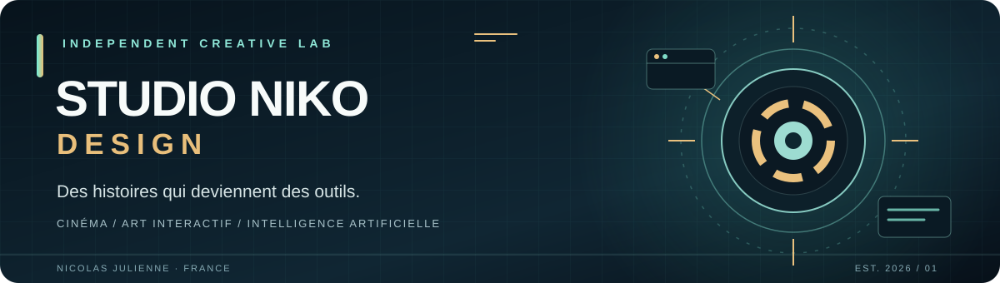

  

# Nicolas Julienne · Studio Niko Design

**Des histoires qui deviennent des outils.**

**Cinéma** · **Art numérique** · **Agents IA** · **Applications utiles**

Créateur indépendant en Loire-Atlantique, France. Je relie narration, design d'interaction et ingénierie pour fabriquer des expériences qu'on peut explorer, tester et améliorer.

*Creative technologist building narrative tools, interactive worlds and human-centered software.*

[**Explorer 6 projets signature**](SHOWCASE.md) · [**Parcourir les 9 univers**](#projets-retenus-classés-par-thème) · [**Écouter Thelovestronautes**](https://soundcloud.com/nicolas-julienne-670246252)

---

## Ce qui rend ces projets différents

| Raconter | Faire vivre | Rendre utile |
| :--- | :--- | :--- |
| **Cinéma & narration** — transformer un scénario en préparation de tournage. | **3D & musique** — inventer des lieux et des instruments qui fonctionnent dans le navigateur. | **IA & services** — construire des assistants avec permissions, données et limites documentées. |

Plutôt qu'empiler les technologies, je pars de **l'expérience à créer**, puis je choisis une architecture qui la rend possible. Le code est consultable, les décisions sont expliquées et les fonctions non validées restent explicitement annoncées comme telles.

## Entrez dans le studio — 4 expériences à explorer

| Votre point de départ | L'expérience | Explorer le travail |
| :--- | :--- | :--- |
| **01 / Créer un film** | [Ouvrir Vision-IA](https://nikoju1977.github.io/Vision-IA/) — atelier de préparation cinématographique | [Voir le code](https://github.com/Nikoju1977/Vision-IA) |
| **02 / Visiter une exposition** | [Entrer dans la galerie 3D](https://galerie-studio-niko-nikoju1977s-projects.vercel.app) — espace d'art numérique | [Voir le code](https://github.com/Nikoju1977/galerie-studio-niko) |
| **03 / Composer un morceau** | [Lancer la machine musicale](https://nikoju1977.github.io/the-lovestronautes-machine/) — séquenceur Web Audio | [Voir le code](https://github.com/Nikoju1977/the-lovestronautes-machine) |
| **04 / Explorer des images** | [Ouvrir MedVision AI Pro](https://nikoju1977.github.io/medicalvisionproai/) — démonstration de visualisation, **sans données médicales réelles** | [Voir le code](https://github.com/Nikoju1977/medicalvisionproai) |

Ces adresses de démonstration sont indiquées dans les README des projets ; leur accessibilité et leur fonctionnement n'ont pas été vérifiés en direct ici. Certains usages nécessitent un navigateur compatible ou une configuration personnelle d'API. Les prototypes biomédicaux ne sont pas des dispositifs médicaux certifiés.

## Six projets signature

| Projet | Ce qu'il faut découvrir | Ce qu'il montre |
| :--- | :--- | :--- |
| **[Vision-IA](https://github.com/Nikoju1977/Vision-IA)** · Cinéma | Préparer un film : scénario, découpage, conducteur et dossier. | **Traçabilité des sources** et workflow éditorial assisté par IA. |
| **[Galerie Studio Niko](https://github.com/Nikoju1977/galerie-studio-niko)** · Art 3D | Visiter une exposition numérique, placer des œuvres et publier une salle. | **Three.js**, création d'espace et chaîne de validation. |
| **[NikoAssist](https://github.com/Nikoju1977/Nikoassist)** · Agents IA | Déléguer à des sous-agents avec budgets et autorisations. | **Python**, tests, garde-fous et travail sur un projet libre crédité. |
| **[MedVision AI Pro](https://github.com/Nikoju1977/medicalvisionproai)** · Imagerie | Explorer des images et séries DICOM avec une interface de visualisation. | **Traitement local**, chiffrement et précautions sur les données. **Prototype non médicalement certifié.** |
| **[Thelovestronautes Machine](https://github.com/Nikoju1977/the-lovestronautes-machine)** · Audio | Composer dans une groovebox au navigateur, avec synthèse et MIDI. | **Web Audio**, interaction temps réel, PWA. |
| **[HandiMonde](https://github.com/Nikoju1977/handimonde)** · Cartographie | Rechercher des informations d'accessibilité de lieux. | **OpenStreetMap**, Leaflet, données ouvertes et limites explicitement documentées. |

**[Lire les six études de projet : problème → choix techniques → code → limites](SHOWCASE.md)**

### En laboratoire

**[AEGIS / White Hat Security OS](https://github.com/Nikoju1977/White-hat)** — cockpit de lecture et de revue défensive des dépôts publics. Un projet expérimental de qualité logicielle, **pas** un audit de sécurité certifié.

### Comment explorer ce travail

**Une expérience à essayer ?** Commence par la [galerie 3D](https://github.com/Nikoju1977/galerie-studio-niko) ou la [machine musicale](https://github.com/Nikoju1977/the-lovestronautes-machine).  
**Un système technique à étudier ?** Ouvre les [tests et scripts de NikoAssist](https://github.com/Nikoju1977/Nikoassist) ou la [chaîne de validation de la galerie](https://github.com/Nikoju1977/galerie-studio-niko).  
**Un projet à évaluer sérieusement ?** Lis le [plan qualité](QUALITY_ROADMAP.md) et les limites de chaque README.

---

## Projets retenus, classés par thème

**41 projets publics sélectionnés parmi 47** sont répertoriés ci-dessous, chacun une seule fois. Les **5 variantes proches** et **1 projet hors sélection éditoriale** ne figurent plus dans cette vitrine. Les critères sont documentés dans [la politique de sélection](CURATION.md), sans suppression de code. Les dépôts privés n'apparaissent pas dans ce catalogue. Les liens pointent vers le code et la documentation, pas nécessairement vers une application déployée.

<strong>01 · Cinéma, image & arts numériques</strong> — 7 projets

### 1. Cinéma, image & arts numériques

| Dépôt | Objet |
| --- | --- |
| [ia-studio-cine](https://github.com/Nikoju1977/ia-studio-cine) | Interface de création cinématographique assistée par IA |
| [Vision-IA](https://github.com/Nikoju1977/Vision-IA) | Préparation et conception de films |
| [Niko-Ultravision](https://github.com/Nikoju1977/Niko-Ultravision) | Restauration et super-résolution d'images et vidéos |
| [Neural-Art-mars-2026](https://github.com/Nikoju1977/Neural-Art-mars-2026) | Expérimentation d'art génératif |
| [galerie-studio-niko](https://github.com/Nikoju1977/galerie-studio-niko) | Galerie d'art immersive 3D |
| [applewatchcadrans](https://github.com/Nikoju1977/applewatchcadrans) | Concepts graphiques de cadrans |
| [Wan2GP](https://github.com/Nikoju1977/Wan2GP) | Outil de génération multimodale fondé sur WanGP ; voir crédits et licence du projet d'origine |

<strong>02 · Musique, audio & création sonore</strong> — 3 projets

### 2. Musique, audio & création sonore

| Dépôt | Objet |
| --- | --- |
| [the-lovestronautes-machine](https://github.com/Nikoju1977/the-lovestronautes-machine) | Séquenceur et synthèse Web Audio |
| [EBM-BRETONNE.](https://github.com/Nikoju1977/EBM-BRETONNE.) | Groovebox électronique aux influences bretonnes |
| [Dbmetre-pro](https://github.com/Nikoju1977/Dbmetre-pro) | Analyse sonore et affichage du niveau micro (dBFS) |

<strong>03 · Santé, bien-être & biomédical</strong> — 9 projets

### 3. Santé, bien-être & biomédical

| Dépôt | Objet |
| --- | --- |
| [medicalvisionproai](https://github.com/Nikoju1977/medicalvisionproai) | Prototype de visualisation d'imagerie |
| [OPENVITA-DT1](https://github.com/Nikoju1977/OPENVITA-DT1) | Prototype d'aide au suivi du diabète de type 1 |
| [jarvisdiabete](https://github.com/Nikoju1977/jarvisdiabete) | Compagnon vocal DiabCare |
| [dermato-ai](https://github.com/Nikoju1977/dermato-ai) | Exploration de la vision artificielle en dermatologie |
| [SCAN-BIOMEDICAL](https://github.com/Nikoju1977/SCAN-BIOMEDICAL) | Exploration d'images biomédicales |
| [agent-biometrique](https://github.com/Nikoju1977/agent-biometrique) | Analyse et visualisation de données biométriques |
| [fibrobot](https://github.com/Nikoju1977/fibrobot) | Agent d'information autour de la fibromyalgie |
| [fibrocare](https://github.com/Nikoju1977/fibrocare) | Journal de suivi de la fibromyalgie |
| [presentation-medtronic](https://github.com/Nikoju1977/presentation-medtronic) | Présentation interactive sur des technologies du diabète |

> **Important :** ces projets sont présentés comme des prototypes et outils d'information. Leur présence ici ne vaut ni validation clinique, ni certification de dispositif médical, ni recommandation thérapeutique.

<strong>04 · Assistants & agents IA</strong> — 3 projets

### 4. Assistants & agents IA

| Dépôt | Objet |
| --- | --- |
| [Nikoassist](https://github.com/Nikoju1977/Nikoassist) | Orchestration multi-agents avec garde-fous |
| [Ron-](https://github.com/Nikoju1977/Ron-) | Assistant conversationnel et interface multimodale |
| [Sage-companion](https://github.com/Nikoju1977/Sage-companion) | Assistant vocal mobile-first |

<strong>05 · Jeux & expériences interactives</strong> — 3 projets

### 5. Jeux & expériences interactives

| Dépôt | Objet |
| --- | --- |
| [Bouh-delivery](https://github.com/Nikoju1977/Bouh-delivery) | Jeu de livraison automobile sur le thème d'Halloween |
| [Cosmo-citrouille](https://github.com/Nikoju1977/Cosmo-citrouille) | Jeu d'aventure spatial pour enfants |
| [miaotris](https://github.com/Nikoju1977/miaotris) | Expérience ludique interactive |

<strong>06 · Sites, services & applications du quotidien</strong> — 7 projets

### 6. Sites, services & applications du quotidien

| Dépôt | Objet |
| --- | --- |
| [Boutique-morgane](https://github.com/Nikoju1977/Boutique-morgane) | Site vitrine et boutique |
| [haomassage-sandra](https://github.com/Nikoju1977/haomassage-sandra) | Site vitrine de massage bien-être |
| [handimonde](https://github.com/Nikoju1977/handimonde) | Carte des lieux accessibles |
| [job-search](https://github.com/Nikoju1977/job-search) | Recherche d'emploi et accompagnement des candidats |
| [patisserie](https://github.com/Nikoju1977/patisserie) | Guide des métiers et maisons de pâtisserie |
| [aylina-is-cooking](https://github.com/Nikoju1977/aylina-is-cooking) | Expérimentation d'assistant culinaire |
| [purescanai](https://github.com/Nikoju1977/purescanai) | Exploration de la composition de produits |

<strong>07 · Industrie, géodonnées & outils métier</strong> — 4 projets

### 7. Industrie, géodonnées & outils métier

| Dépôt | Objet |
| --- | --- |
| [cockpit-mecaria](https://github.com/Nikoju1977/cockpit-mecaria) | Cockpit de qualité, production et amélioration continue |
| [Metrology-OS](https://github.com/Nikoju1977/Metrology-OS) | Gestion métrologique et parc d'instruments |
| [aegis-earth-mobile](https://github.com/Nikoju1977/aegis-earth-mobile) | Application géospatiale mobile-first |
| [radar-de-niko](https://github.com/Nikoju1977/radar-de-niko) | Collecte et restitution de veille structurée |

<strong>08 · Jardin, symbolique & spiritualité</strong> — 4 projets

### 8. Jardin, symbolique & spiritualité

| Dépôt | Objet |
| --- | --- |
| [oracle-du-jardinier](https://github.com/Nikoju1977/oracle-du-jardinier) | Assistant de jardinage et permaculture |
| [tarot-de-niko](https://github.com/Nikoju1977/tarot-de-niko) | Tarot numérique et journal symbolique |
| [oeil-hermes](https://github.com/Nikoju1977/oeil-hermes) | Grimoire numérique de correspondances symboliques |
| [les-annales-akashiques](https://github.com/Nikoju1977/les-annales-akashiques) | Expérience de réflexion spirituelle |

<strong>09 · Cybersécurité & qualité logicielle</strong> — 1 projet

### 9. Cybersécurité & qualité logicielle

| Dépôt | Objet |
| --- | --- |
| [White-hat](https://github.com/Nikoju1977/White-hat) | Cockpit de cybersécurité défensive et revue de dépôts publics |

---

## Méthode de travail

**01 · Concevoir** — identifier un usage, écrire le parcours, prototyper une interface.  
**02 · Construire** — privilégier le web, les standards ouverts et des composants compréhensibles.  
**03 · Vérifier** — rendre lisibles les tests, les autorisations et les limites ; différencier prototype et production.

**Technologies rencontrées :** JavaScript / TypeScript, Python, Web Audio, Three.js, PWA, IndexedDB, WebGPU / ONNX Runtime Web, APIs d'IA, GitHub Actions et Vercel.

<small>Le catalogue ci-dessus est une sélection éditoriale de dépôts publics, et non une promesse de disponibilité ou de fonctionnement de chaque application. Les projets médicaux sont expérimentaux et ne remplacent pas un professionnel de santé. Les projets issus d'un code tiers conservent les crédits et licences d'origine.</small>

**[Études de projet](SHOWCASE.md)** · **[Politique de sélection](CURATION.md)** · **[Plan qualité](QUALITY_ROADMAP.md)**

**STUDIO NIKO DESIGN** · Construire des mondes. Concevoir des outils. Documenter le réel.

